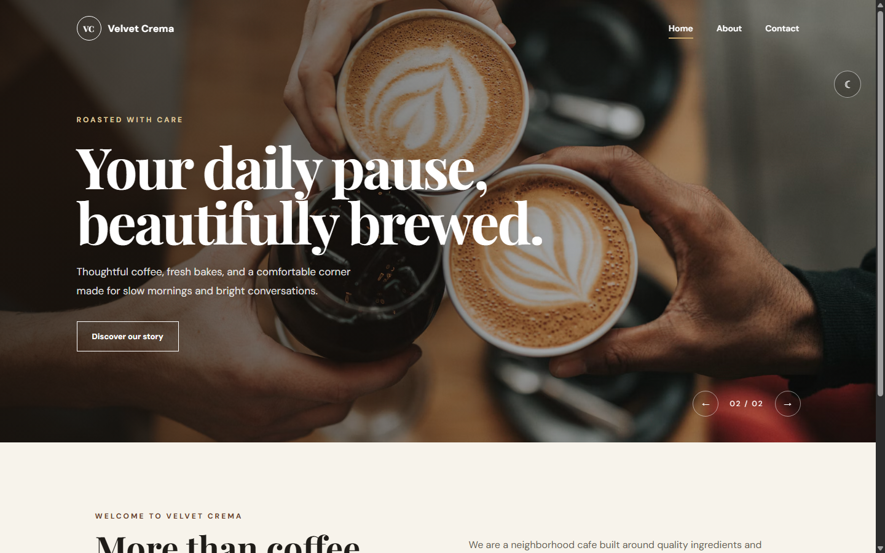
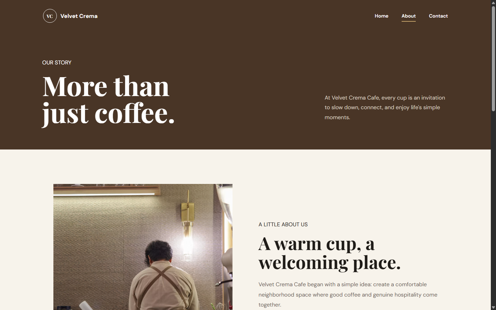
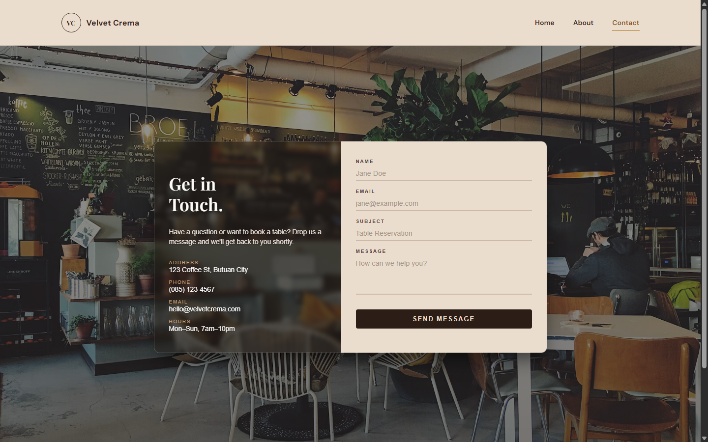

# Velvet Crema Cafe

## Project Information

- **Group Name:** GWLM1
- **Section:** IT-110
- **Members:**
  - CJ Capilitan
  - Niño Calubag
  - Nicholas Daniel Briones

## App Theme

Velvet Crema Cafe is a warm, modern neighborhood coffee shop website with a cozy cafe theme. Its design uses brown, cream, and gold tones, large readable typography, welcoming imagery, and responsive layouts.

The app contains three pages:

- Home
- About
- Contact

## Member Assignments

| Member | Assigned Module | Branch Name |
|---|---|---|
| CJ Capilitan | Home page, navigation, and shared layout | `dev-Member1-Capilitan` |
| Niño Calubag | About page | `dev-Member2-Calubag` |
| Nicholas Daniel Briones | Contact page and form validation | `dev-Member3-Briones` |

## Page Screenshots

### Home



### About



### Contact



## Requirements

- PHP 8.3 or newer
- Composer
- Node.js and npm
- A database supported by Laravel

## Steps to Run the Project

1. Clone the repository:

   ```bash
   git clone <repository-url>
   cd Lara-Proj-GWLM1-Capilitan-Calubag-Briones
   ```

2. Install PHP dependencies:

   ```bash
   composer install
   ```

3. Install frontend dependencies:

   ```bash
   npm install
   ```

4. Create the environment file:

   ```bash
   cp .env.example .env
   ```

   On Windows Command Prompt, use:

   ```cmd
   copy .env.example .env
   ```

5. Generate the Laravel application key:

   ```bash
   php artisan key:generate
   ```

6. Configure the database in `.env`, then run migrations:

   ```bash
   php artisan migrate
   ```

7. Build the frontend assets:

   ```bash
   npm run build
   ```

8. Start the Laravel development server:

   ```bash
   php artisan serve
   ```

9. Open `http://127.0.0.1:8000` in a browser.
